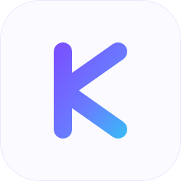

<p align="center">
  
</p>

<p align="center">
  <a href="Readme.md">简体中文</a> · <a href="Readme.en.md">English</a>
</p>

# Git-K

A native Git client written in Go. Its interaction model is inspired by [git-cola](https://github.com/git-cola/git-cola), while the window, widgets and editors come from [mygo](https://github.com/egoist/mygo).

The goal is **small, fast, no WebView, no cgo**: one static binary, no browser runtime. Every Git operation runs the local `git` executable, so behavior, error messages and hooks match your terminal.

## Why Git-K

- **Native UI, no WebView**: mygo draws the window directly; no HTML/JS, no Electron or WebView2 runtime.
- **No cgo**: release builds use `CGO_ENABLED=0` and cross-compile for Linux, macOS and Windows on amd64 and arm64.
- **The git you know**: status, diffs, staging, commits, push and pull all call `git`; no object database reimplementation and no go-git.
- **One window, many repositories**: each repository gets a tab; opening the same repository again focuses its existing tab. Starting from any subdirectory resolves to the repository root.
- **git-cola-like workspace**: files in a status list on the right, commit message and diff on the left, with grouped diffs and multi-select staging.
- **Commit graph**: a branch page with a lane graph, a main-line selector (one local branch or `ALL`), merge curves and diamond merge nodes; forked child lanes curve into their common parent.
- **Rebindable shortcuts**: record new chords in Settings; bindings persist in `settings.json` and the footer/tooltips follow them.

## Running

```sh
git-k                       # open the repository containing the current directory
git-k /path/to/repo         # open a repository
git-k -d /path/to/repo      # same, explicit directory
git-k -version              # print the version
```

If an instance is already running, a second launch hands its arguments to that instance and focuses the existing window.

For development:

```sh
make run                    # CGO_ENABLED=0 go run . -d test-repo
```

`test-repo` is a small working tree shipped with the project for trying the status list, diffs and commits.

## Features

- [x] Repository discovery from any subdirectory, deduplicated by the canonical `git rev-parse --show-toplevel`
- [x] Status from one `git status --porcelain=v2 -z`, split into staged / conflicts / modified / untracked
- [x] Multi-select stage, unstage, stage all, unstage all; double-click a row to toggle staging
- [x] Diffs for staged, modified, untracked and conflicted files, grouped summaries with diffstat, and a patch size cap
- [x] Commit with summary and body, sent through `git commit -F -`; drafts are written to `.git/GIT_K_MSG`, and a conflicted merge starts from git's `MERGE_MSG` so the commit stays a merge commit
- [x] Amend with `Ctrl+M`, including a reset of the index to HEAD
- [x] Branch page: commit graph, commit message, changed files and per-file diff (against the first parent)
- [x] Main-line selector: follow one local branch or show all local branches with `ALL`
- [x] Stashes: list them, summarize added/modified/deleted files, show every changed file, and click a file for its diff; Pop / Drop from the context menu (Drop asks first)
- [x] File watching for the worktree and `.git`, with automatic status refresh
- [x] Context actions: revert modifications and delete untracked files, both with confirmation
- [x] Themes: system / light / dark and default / ocean / forest / warm palettes from Lobe UI tokens
- [x] Rendering: a settings switch turns off GPU rendering for CPU rasterization (restart required), avoiding black flashes from some Linux/X11 drivers on text-heavy pages
- [x] Frameless window with a custom title bar, remembered position and size, and a recent-repository home page
- [x] Configurable keymap with recording and conflict handling in the settings dialog
- [x] Release builds for six targets with `tar.gz` / `zip` archives and `SHA256SUMS`

## Default shortcuts

| Action | Keys |
|---|---|
| Stage selection | `Ctrl+S` |
| Stage all | `Ctrl+Shift+S` |
| Unstage | `Ctrl+U` |
| Refresh | `Ctrl+R` / `F5` |
| Commit | `Ctrl+Enter` |
| Amend last commit | `Ctrl+M` |
| Push / Pull | `Ctrl+P` / `Ctrl+L` |
| Workspace / Branches | `Ctrl+1` / `Ctrl+2` |
| Next / previous tab | `Ctrl+Tab` / `Ctrl+Shift+Tab` |
| Close tab | `Ctrl+W` |
| Minimize | `Ctrl+Q` |

Every action is rebindable in Settings → Shortcuts.

## Build and test

Go 1.27.3 and the local `git` are required. The mygo version is pinned in `go.mod`.

```sh
make run      # development run (CGO_ENABLED=0)
make test     # CGO_ENABLED=0 go test ./...
make vet      # CGO_ENABLED=0 go vet ./...
make build    # static binary ./git-k
make release  # release archives for six platforms under dist/
make fmt      # go fmt ./...
make icon     # regenerate PNG / ICO / Windows .syso from assets/icon.svg
```

Tests isolate user configuration and never touch the network. UI tests run the full view headlessly with mygo's `ui.NewTester`.

## Known limitations

Implemented today: repository discovery, status groups, multi-select staging, diffs, commit/amend, file watching, recent repositories, configurable shortcuts, and browsing the commit graph.

Not implemented yet:

- Partial staging (hunk / line)
- Branch checkout, creating/applying stashes, merge / rebase / cherry-pick
- A dedicated combined-diff view for conflicts, image diffs, submodule operations
- Commit templates, signing, spellcheck, multiple windows

## Credits

- [git-cola](https://github.com/git-cola/git-cola): inspiration for the interaction and layout
- [mygo](https://github.com/egoist/mygo): native window, widgets and editors
- [Lobe UI](https://github.com/lobehub/lobe-ui): theme design tokens

## License

[Apache-2.0](LICENSE)
